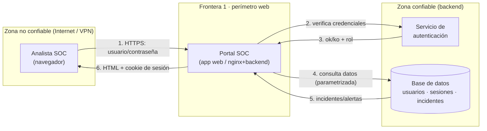

# Laboratorio UT3 · Parte B — Diagrama de flujo de datos del portal SOC (referencia)

> Base para el modelado STRIDE (evidencia **PPS-E5**). Este DFD es el punto de partida: el
> alumnado lo redibuja (draw.io/excalidraw/papel) y sobre él enumera las amenazas.
> Referencia: OWASP Threat Modeling; unidad `PPS/unidades/UT3-asvs-superficie-riesgo.md`.

## Convención de un DFD para modelado de amenazas

- **Entidad externa** (rectángulo): actor fuera de nuestro control (usuario, atacante).
- **Proceso** (círculo): código que transforma datos (la app, el servicio de auth).
- **Almacén de datos** (dos líneas paralelas): base de datos, ficheros, caché.
- **Flujo de datos** (flecha): por dónde viaja un dato entre elementos.
- **Frontera de confianza** (línea discontinua): dónde cambia el nivel de confianza. **El
  riesgo vive en las fronteras**: un dato que las cruza debe validarse/autenticarse.

## DFD del portal SOC de xest

## Inventario de elementos (lo que STRIDE debe recorrer, sin dejarse ninguno)

| # | Elemento | Tipo | Frontera que toca |
|---|---|---|---|
| E1 | Analista SOC (navegador) | Entidad externa | F1 |
| P1 | Portal SOC (app web) | Proceso | F1, F2, F3 |
| P2 | Servicio de autenticación | Proceso | F2 |
| D1 | Base de datos (usuarios, sesiones, incidentes) | Almacén | F3 |
| **F1** | Internet/VPN ↔ Portal | Frontera de confianza | — |
| **F2** | Portal ↔ Auth | Frontera de confianza | — |
| **F3** | Portal ↔ Base de datos | Frontera de confianza | — |

> Regla del ejercicio: **cada proceso, almacén, flujo y frontera** debe aparecer en la tabla
> STRIDE. Un elemento sin fila es un elemento sin analizar. Y cada amenaza debe llevar su
> **control mitigador**: una amenaza sin control está *nombrada*, no *modelada*.
